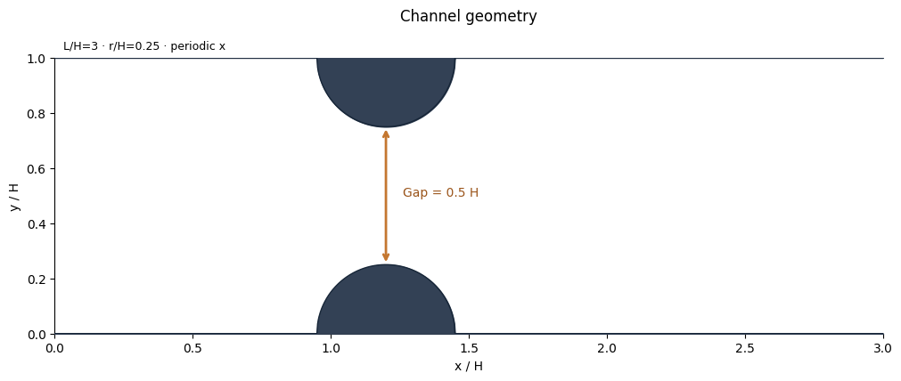

# Gaussian Parcel PINN

**مدل اصلی ابر ذرات گاوسی با هندسهٔ جدید:** [notebook مستقل گرفتگی دوطرفه](BilateralConstriction_GPU.ipynb) · [راهنمای فارسی](docs/CONSTRICTION_GPU_FA.md) · [کد آمادهٔ دانلود](deliverables/BilateralConstriction_GPU_code.zip). حل زمانی سیال–پارسل، کوپل دوطرفهٔ گاوسی، مرز تناوبی، نیروی محرک و چهار حالت قبلی حفظ شده‌اند؛ فقط گرفتگی و تغییرهای لازم دامنه، مرز و شرط اولیه افزوده شده‌اند. بودجهٔ هدف GPU همان ۵۵ دقیقه است. [گزارش بررسی‌ها](docs/CONSTRICTION_CHECKS.md). برداشت قبلیِ جریان پایای بدون ذره در archive حفظ شده و مسیر پیش‌فرض این notebook نیست.



**اجرای GPU با بودجهٔ زمانی:** [notebook مستقل GPU](GaussianParcelPINN_GPU.ipynb) · [راهنمای فارسی و خروجی‌ها](docs/GPU_NOTEBOOK_FA.md). مدل اصلی پارسل گاوسی دوبعدی، چهار حالت، هدف ۵۵ دقیقه شامل حداکثر ۳۵ دقیقه آموزش و زمان جدا برای شکل‌ها و انیمیشن. کد و مراجع تحلیلی لازم داخل notebook هستند؛ GPU و دقت نهایی باید در اجرای واقعی بررسی شوند.

[باز کردن مستقیم در Google Colab](https://colab.research.google.com/github/mohrezsayeh90-ai/final_cloud_code/blob/main/GaussianParcelPINN_GPU.ipynb) · [بستهٔ کد GPU](deliverables/GaussianParcelPINN_GPU_code.zip)

افزونهٔ جدید برای مقایسهٔ مستقیم دوران تعادلی استوانه با مقاله آماده شده است: [راهنمای اعتبارسنجی CO01 و CO02](docs/COUETTE_VALIDATION.md)، [جدول و گزارش اجرا](outputs/couette_validation/REPORT.md). این افزونه PINN با دادهٔ کمکیِ حل مستقل FEM است و دامنهٔ تأیید آن در گزارش مشخص شده است.

نسخهٔ اولیه مطابق درخواست شما **حل دوبعدی** است: سیال تراکم‌ناپذیر، مسیر دوبعدی parcelهای کروی، کوپل دوطرفهٔ گاوسی و آموزش مبتنی بر معادلات. نمای عمق‌دار صرفاً نمایش هندسیِ حل دوبعدی است. هیچ نتیجهٔ آزمایشی، عدد همگرایی یا دادهٔ مرجع به جای پیش‌بینی شبکه ساخته نمی‌شود.

## اجرا

Python 3.12 توصیه می‌شود. بستهٔ `Validation_Pack.zip` خودتان را کنار پروژه باز کنید؛ پوشه باید `case_catalog.json` و `data/` داشته باشد.

```bash
python -m venv .venv
source .venv/bin/activate
python -m pip install --index-url https://download.pytorch.org/whl/cpu torch==2.6.0
python -m pip install -r requirements.txt
python run.py --preset demo --validation-pack ./Validation_Pack --out outputs/my_run
```

در ویندوز فعال‌سازی با `.venv\Scripts\activate` است. اگر PyTorch سازگار با GPU دارید، از نصب مجدد آن با نسخهٔ CPU خودداری کنید. مسیر `run.py` روی CPU و float64 اجرا می‌شود؛ برای آموزش CUDA از notebook جدید GPU یا `run_gpu.py` استفاده کنید.

- `smoke`: بررسی مسیر اجرا؛ آموزش بسیار کوتاه و نامناسب برای استنتاج فیزیکی.
- `demo`: چهار حالت، یک seed، آموزش متوسط برای بررسی روش و خروجی‌ها.
- `paper`: بودجهٔ بیشتر، شبکهٔ بزرگ‌تر، quadrature ریزتر و سه seed. نام این تنظیم به معنای تضمین دقت یا آمادگی مقاله نیست؛ اجرا و تحلیل عدم قطعیت لازم است.

تنظیمات اجرای تحویل‌شده در `configs/evaluated.json` ذخیره شده است؛ برای بازتولید همان بودجهٔ آموزش از `--preset demo --config configs/evaluated.json` استفاده کنید. نتایج نمونه مربوط به یک seed هستند و جای مطالعهٔ چند seed یا حل مستقل مرجع را نمی‌گیرند.

فایل `outputs/my_run/index.html` را پس از اجرا باز کنید. گزارش مستقل از اینترنت است. برای بازاجرا نام خروجی جدید بدهید تا نتایج قبلی بازنویسی نشوند.

می‌توانید خود فایل ZIP را نیز بدهید: `--validation-pack ./Validation_Pack.zip`؛ استخراج داده با بررسی مسیرها در cache موقت انجام می‌شود.

نسخهٔ تک‌فایلیِ همین کد نیز موجود است: به‌جای `run.py` از `gaussian_parcel_pinn.py` با همان آرگومان‌ها استفاده کنید. فایل `GaussianParcelPINN.ipynb` برای اجرای مرحله‌ای در Jupyter آماده است. هر دو همچنان به وابستگی‌های Python و بستهٔ مرجع نیاز دارند.

## خروجی‌ها

- `REPORT.md` و `summary.json`: وضعیت واقعی آموزش، خطاها، مفروضات و محدودیت‌ها.
- `paper_metrics.csv` و `paper_metrics.tex`: جدول یکپارچهٔ پارامترها، میانگین سرعت‌ها و خطاها برای استفاده در متن مقاله پس از بررسی کیفیت.
- `validation/verification.json`: نتایج V01–V10 به ترتیب بسته، همراه با معیارها و خطاها.
- `validation/literature_audit.csv`: بررسی تک‌تک ۵۱ حالت مرجع، علت اجرا نشدن یا ناسازگاری فیزیک.
- `figure_manifest.json`: مسیر فایل‌ها و کپشن علمی هر شکل.
- هر حالت: نمودار آموزش، میدان سرعت/فشار/ورتیسیتی/کسر حجمی، پروفیل کانال، مسیرها، سرعت ذرات، نمای عمق‌دار و موازنه‌های انرژی و تکانه در PNG/PDF/SVG.
- انیمیشن GIF و، اگر ffmpeg در دسترس باشد، MP4.
- `particles.csv`, `diagnostics.csv`, `fields.npz`, `checkpoint.pt`: دادهٔ خام و وزن شبکه.
- `config.json`, `runtime.json`, `reference_manifest.json`: تنظیمات، نسخه‌ها و SHA-256 ورودی‌ها.

عنوان شکل‌ها کوتاه است و عبارت همگرا/ناهمگرا ندارد. وضعیت عددی در متن گزارش و فایل‌های وضعیت باقی می‌ماند؛ حذف آن از عنوان، پنهان‌سازی کیفیت نتیجه نیست.

برای بازتولید همهٔ شکل‌ها از checkpointهای ذخیره‌شده، بدون آموزش مجدد:

```bash
python render.py outputs/my_run
```

## مدل و دامنهٔ اعتبار

طول کانال بی‌بُعد ۳ و ارتفاع ۱ است؛ جهت x تناوبی و دیواره‌های y ثابت و بدون لغزش‌اند. جریان با نیروی حجمی ثابت `12/Re` هدایت می‌شود؛ پروفیل اولیه `u=6y(1-y), v=0` است. این کانال تناوبی، ورودی و خروجیِ باز ندارد.

قطر فیزیکی از `St`, `Re` و نسبت چگالی محاسبه می‌شود. تعداد نمایندگی‌شده از بارگذاری کل محاسبه می‌شود، تا افزایش تعداد parcelها جرم کل را تغییر ندهد. در حل دوبعدی، `depth_ratio=B/H` قرارداد جرم و نیرو بر واحد عمق را مشخص می‌کند. نیرو بر پایهٔ drag کروی است؛ این مدل، استوانهٔ جامد نامتناهی دوبعدی نیست.

مدل پایه رقیق و بدون برخورد است؛ `collision="soft_sphere"` به‌صورت اختیاری برای ذرات فیزیکی با multiplicity=1 موجود است. این گزینه بارگذاری را از تعداد و جرم ذرات محاسبه می‌کند، نه از مقدار درخواستی `loading`. برای آن نه روان‌کاری، نه اصطکاک مماسی و نه دوران پیاده شده است؛ اعتبار آن باید جداگانه بررسی شود. آزمون‌های برخورد و نرخ برخورد موجود در V05–V08 بررسی اجزای مستقل‌اند؛ V08 به معنای پیاده‌سازی گاز برخوردی کامل داخل PINN نیست.

مرجع PDF شما چند مدل جایگزین معرفی می‌کند. پیاده‌سازی حاضر مدل رقیق Eulerian–Lagrangian با drag منظم‌شده است؛ همهٔ FCM، ERPP، MP-PIC و مدل‌های غلیظ را یک مدل واحد فرض نمی‌کند. جزئیات معادلات و واحدها در [docs/METHOD.md](docs/METHOD.md) آمده است.

## تغییر پارامترها

از `--config configs/custom.json` برای بازنویسی کلیدهای تنظیمات استفاده کنید. نمونه:

```json
{
  "epochs": 2000,
  "ode_epochs": 2200,
  "quadrature": [24, 24],
  "seeds": [7, 17, 29],
  "cases": [
    {"name": "baseline", "stokes": 0.2, "loading": 0.05}
  ]
}
```

`gravity` شتاب مؤثرِ شامل اثر شناوری است؛ دوباره شناوری اضافه نکنید. `width` عرض فیلتر است و شعاع ذره نیست. طول‌ها، سرعت‌ها، زمان و فشار همگی بی‌بُعدند؛ نگاشت SI در سند روش آمده است.

شبکهٔ سیال و شبکهٔ مسیر ذرات جدا هستند و به‌طور همزمان آموزش می‌بینند. معادلات ناویر–استوکس، پیوستگی، `dq/dt=v` و معادلهٔ سرعت ذرات در loss قرار دارند. ICها، تناوب و شرط دیواره به‌صورت سخت در ansatz اعمال شده‌اند. داده‌های analyticalِ بسته در آموزش وارد نمی‌شوند و فقط در ارزیابی پس از آموزش خوانده می‌شوند.

## اعتبارسنجی و استفاده در مقاله

**Verification با validation آزمایشگاهی یکسان نیست.** V01، V02 و V10 با PINN حل و با جواب تحلیلی مستقل مقایسه می‌شوند. V03–V09 صحت نرمال‌سازی، انتگرال، انتقال نیرو، برخورد و نرخ آماری را بررسی می‌کنند. مرجع‌های غلیظ، اجسام finite-size و ذرات غیرکروی به فیزیک بیشتری نیاز دارند؛ از تطبیق منحنی‌هایی با معادلات متفاوت نتیجهٔ اعتبارسنجی استخراج نمی‌شود. داده‌های مثال مصنوعی بسته اصلاً وارد مقایسه نمی‌شوند.

معیار خطای پروژه پیش از آموزش ذخیره می‌شود. رسیدن به آن شرط لازم است، نه تضمین صحت فیزیکی. خطای کم loss به‌تنهایی کافی نیست؛ residual نقاط مستقل، `Re_p`، کسر حجمی، خروج ذرات از دیواره و موازنه‌ها را نیز بررسی کنید. خروجی اجرای نمونه ممکن است به معیار نرسیده باشد و فقط نتیجهٔ تشخیصی باشد.

مطالعات کنترل‌شده:

```bash
python study.py --study quadrature --preset demo --validation-pack ./Validation_Pack --out outputs/quadrature_study
python study.py --study width --preset demo --validation-pack ./Validation_Pack --out outputs/width_study
python study.py --study parcels --preset demo --validation-pack ./Validation_Pack --out outputs/parcel_study
python study.py --study budget --preset demo --validation-pack ./Validation_Pack --out outputs/budget_study
python study.py --study time_sampling --preset demo --validation-pack ./Validation_Pack --out outputs/time_study
```

در PINN زمان پیوسته است و «گام زمانی حلگر» وجود ندارد؛ مطالعهٔ تعداد نقاط زمانی و بودجهٔ آموزش جای آن را می‌گیرد. مطالعهٔ عرض فیلتر حساسیت مدل است، نه همگرایی شبکهٔ مکانی. مطالعهٔ تعداد parcel با بارگذاری ثابت انجام می‌شود و همچنان به چند seed برای بررسی نویز نمونه‌برداری نیاز دارد. این اسکریپت‌ها اجرایی‌اند؛ وجود آن‌ها به معنای انجام‌شدن مطالعه در نتایج نمونه نیست.

## ادامهٔ اجرا پس از خطای آموزش

پایان بودجهٔ آموزش مانع تولید نمودار نیست. loss یا gradient نامحدود، یا خطای runtime در آموزش، باعث بازیابی بهترین checkpoint محدود می‌شود. اگر هیچ گام آموزشی سالم ثبت نشده باشد، خروجی با برچسب `initialized` در فایل وضعیت مشخص است. هیچ حل تحلیلی یا trajectory ساختگی جایگزین PINN نمی‌شود. خطای یک حالت، مانع اجرای سایر حالت‌ها و نوشتن گزارش نهایی نمی‌شود. ورودی نامعتبر، خرابی فایل‌ها یا نبود وابستگی‌ها خطای واقعی محسوب می‌شود؛ نمی‌توان برای هر خطای سیستم خروجی فیزیکی تضمین کرد.

برای CI از `--strict` استفاده کنید: اگر معیارهای لازم پاس نشوند کد خروج ۲ است. در حالت عادی، عدم رسیدن به دقت مطلوب مانع پایان workflow نیست؛ خطای اجرایی یک حالت کد خروج ۱ می‌دهد. خطاهای شکل‌ها جدا در `plot_errors.json` ثبت می‌شوند. MP4 اختیاری است.

## آزمون‌ها

```bash
python -m unittest discover -s tests -v
python run.py --preset smoke --validation-pack ./Validation_Pack --out outputs/smoke
```

آزمون‌های واحد بقای نیرو و کار، sampling ثابت، مرز تناوبی، residual تحلیلی Taylor–Green، شرط سخت دیواره و IC، مشتق‌های کوپل، قرارداد عمق، برخورد و بازیابی پس از خطای عددی را پوشش می‌دهند.

## منابع و منشأ

مبنای فیزیکی: فایل ارسالی `Gaussian_Parcel_Fluid_Particle_Physics.pdf`، به‌ویژه بخش‌های ۲–۹، ۱۱–۱۳ و ۱۸–۲۰. داده‌ها و مقیاس‌ها: `Validation_Pack/Validation_Atlas.md` و کاتالوگ همان بسته. هر دو مستند به‌عنوان منابع علمی بررسی شده‌اند؛ توصیه‌هایشان جای دستور کاربر را نمی‌گیرد. ارجاع مقاله‌ها در بستهٔ اصلی حفظ شده و در audit خروجی درج می‌شود. داده‌های رسمی sphere همراه این کد بازتوزیع نمی‌شوند؛ بستهٔ اصلی خودتان را به آن بدهید.
