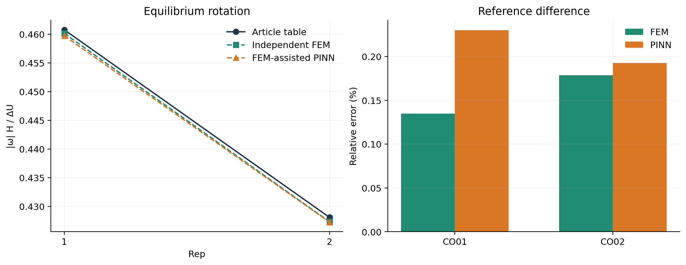
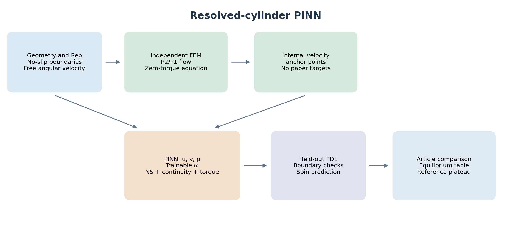

# اعتبارسنجی دوران تعادلی استوانه

این افزونه برای مقایسهٔ مستقیم با **CO01 از مقالهٔ Garcia‑Villalba و همکاران، 2023** ساخته شده است. CO02 از همان مقاله، شرط دوم برای بررسی روند تغییر با رینولدز است. مرجع مقاله یک حل عددی است؛ این مقایسه، آزمایش تجربی نیست.

ارجاع: *An efficient method for particle-resolved simulations of neutrally buoyant spheres*، DOI: [10.1016/j.compfluid.2023.105936](https://doi.org/10.1016/j.compfluid.2023.105936)، بخش 4.1، جدول تعادل و شکل 2(b). اطلاعات، جدول و تصویر مرجع در بستهٔ ورودی کاربر موجود است. دریافت مستقیم نسخهٔ arXiv به‌علت سیاست شبکهٔ محیط ممکن نشد؛ اعداد مرجع از بستهٔ ارسالی با ثبت SHA-256 خوانده می‌شوند.

## دقیقاً چه چیزی مقایسه می‌شود؟

کمیت هدف `|ω| H / ΔU` در حالت پایای استوانه روی خط تقارن کانال است. مقدار مرجع برای `Rep=1` برابر **0.4608** و برای `Rep=2` برابر **0.4281** است. مرکز `y/H=0.5` در مدل تعیین شده است؛ بنابراین موقعیت تعادل یا مهاجرت از `y/H=0.4` در این آزمون پیش‌بینی و تأیید نمی‌شود.

| پارامتر | مقدار |
|---|---|
| دامنه | دوبعدی، طول 2 و ارتفاع 1 |
| قطر | `D/H = 0.25` |
| نسبت چگالی | 1؛ شتاب جسم در حالت پایا صفر است |
| تعریف رینولدز | `Rep = ΔU a² / (H ν)`, `a=D/2` |
| ویسکوزیته | `ν = 1/(64 Rep)` |
| مرز x | تناوبی |
| دیواره‌ها | بدون لغزش، سرعت‌های 0 و 1 در دستگاه آزمایشگاه |
| دستگاه حل | حرکت انتقالی با سرعت 0.5؛ دیواره‌ها با سرعت‌های −0.5 و +0.5 |
| استوانه | سطح واقعی بدون لغزش، سرعت دوران مجهول، گشتاور خالص صفر |

## روش حل

یک حل مستقل المان محدود Taylor–Hood با المان‌های سرعت P2 و فشار P1 ساخته شده است. سرعت دوران یک مجهول سراسری است و شرط کار مجازیِ دوران، گشتاور خالص صفر را اعمال می‌کند. ماتریس تنش متقارن استفاده می‌شود؛ حذف بخش متقارنِ تنش، گشتاور را نادرست می‌کند. شرایط تناوبی و قید فشار به‌صورت سخت اعمال شده‌اند. جملهٔ جابه‌جایی ناویر–استوکس با نیوتن و جست‌وجوی خطی حل می‌شود. دو شبکهٔ مکانی برای حساسیت رزولوشن استفاده می‌شوند.

سپس یک **PINN با دادهٔ کمکی شبیه‌سازی** آموزش می‌بیند. دادهٔ کمکی، میدان سرعت داخلیِ حل مستقل FEM است؛ هیچ عدد دوران یا نقطهٔ منحنی مقاله به شبکه داده نمی‌شود. خود `ω` یک پارامتر قابل آموزش است. معادلات ناویر–استوکس، پیوستگی و گشتاور صفر در loss باقی می‌مانند و شرط سرعت روی استوانه و دیواره‌ها سخت است. ویژگی‌های تناوبی و چندقطبیِ هندسی برای نمایش میدان نزدیک استوانه استفاده می‌شوند.

آزمون‌های PINN بدون دادهٔ کمکی در اجراهای مقدماتی به دقت لازم نرسیدند؛ آن‌ها در تاریخچهٔ مخزن حفظ شده‌اند و نتیجهٔ موفق معرفی نمی‌شوند. روش نهایی را نباید PINN کاملاً بدون داده نامید.

## اجرا

از ریشهٔ پروژه:

```bash
python -m pip install -r requirements.txt
python validate_couette.py --out outputs/my_couette_validation
```

اجرای کامل دو شرط و دو شبکهٔ مکانی را تولید می‌کند. برای فقط CO01 از `--cases 1` استفاده کنید. نتایج قبلی بازنویسی نمی‌شوند؛ نام خروجی جدید انتخاب کنید.

```bash
python validate_couette.py --cases 1 --out outputs/CO01_new
python render_couette.py outputs/my_couette_validation
python -m unittest discover -s tests -v
```

`--strict` پس از نوشتن گزارش، در صورت پاس نشدن معیارهای اعلام‌شده کد خروج ۲ می‌دهد. معیار مقایسهٔ دوران پیش از آموزش ۱۰٪ تعیین شده است؛ معیارهای فیزیکی مستقل عبارت‌اند از RMS مومنتوم و پیوستگی کمتر از 0.01 و گشتاور نرمال‌شده کمتر از 0.002. خود میزان خطا، نه فقط برچسب قبول/رد، در گزارش می‌آید.

## خروجی‌های قابل استفاده

[گزارش و جدول نتیجه](../outputs/couette_validation/REPORT.md) شامل مقادیر واقعی اجرا و خطاهاست. [جدول CSV](../outputs/couette_validation/comparison.csv) و [جدول LaTeX](../outputs/couette_validation/comparison.tex) برای انتقال اعداد به مقاله آماده‌اند. شکل‌ها در PNG/PDF/SVG، همراه با داده‌های خام، checkpointها، انیمیشن و گزارش استخراج منحنی مرجع ذخیره می‌شوند.





## دامنهٔ نتیجه

این آزمون، مقایسهٔ دوران تعادلیِ **افزونهٔ دارای سطح واقعی استوانه** است. مدل گاوسیِ پارسل نقطه‌ای، برخوردها، تاریخچهٔ شتاب و مسیر مهاجرت با این نتیجه تأیید نمی‌شوند. در شکل مقایسهٔ منحنی، فقط تراز پایای مدل روی انتهای منحنی مرجع قرار می‌گیرد؛ مسیر گذرای مقاله به‌عنوان پیش‌بینی شبکه نمایش داده نمی‌شود. عدم قطعیت چند seed هنوز بررسی نشده است.
