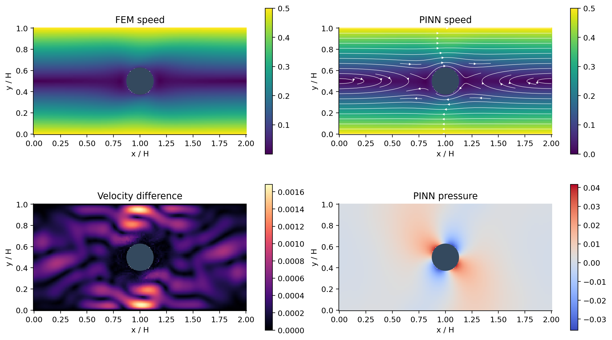
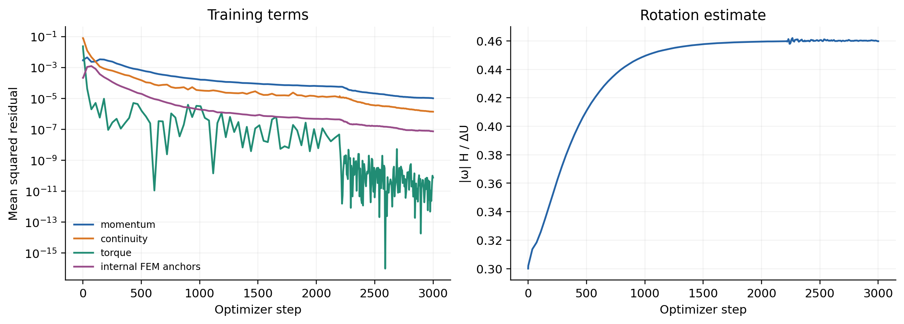
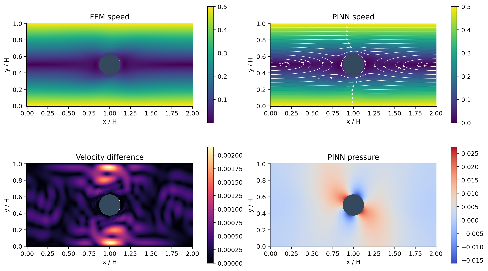
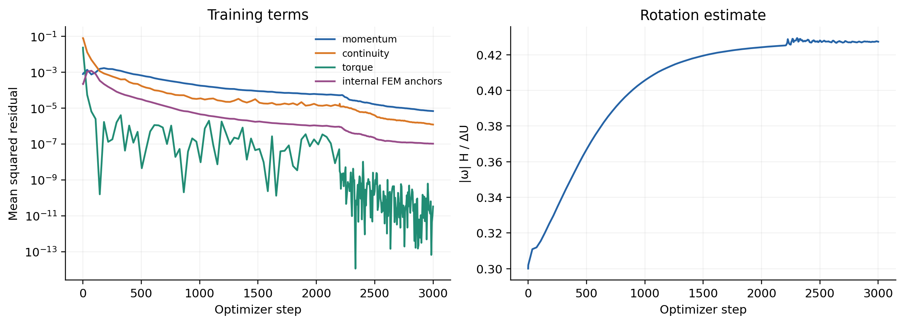
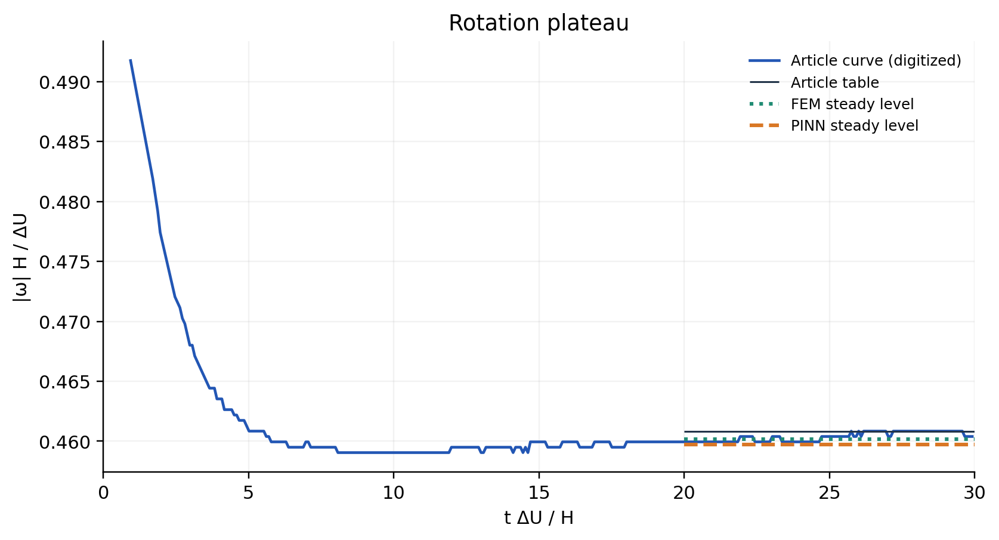
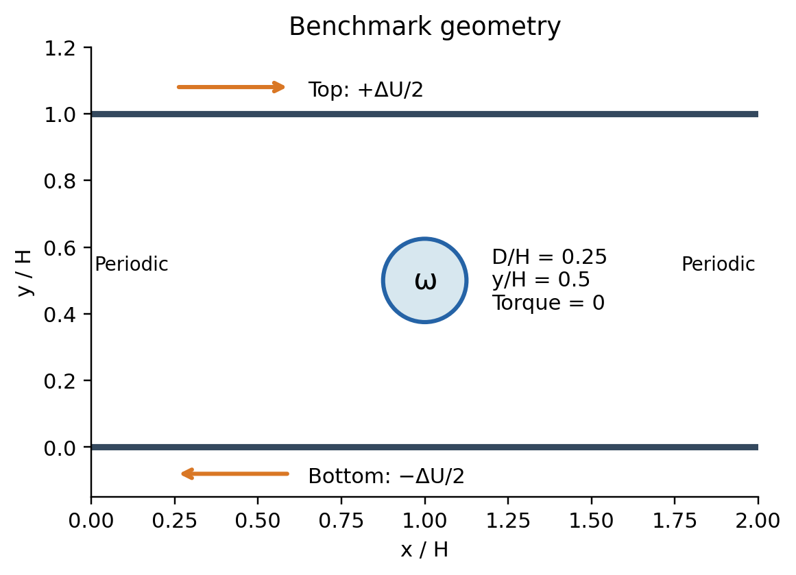
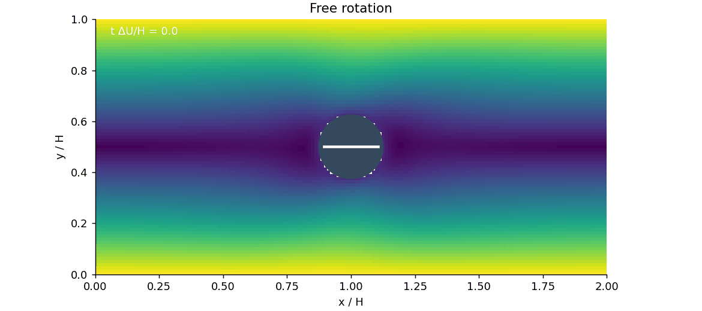

# Couette equilibrium-spin comparison

Primary case: CO01. CO02 is a second operating condition from the same publication to test the Reynolds-number trend.

The validated observable is equilibrium spin at the prescribed symmetry-plane position. This report does not validate migration, startup dynamics, or the original Gaussian parcel closure.

| Case | Paper | FEM | FEM error | PINN | PINN error | NS RMS | Divergence RMS |
|---|---:|---:|---:|---:|---:|---:|---:|
| CO01 | 0.460800 | 0.460179 | 0.135% | 0.459740 | 0.230% | 0.003322 | 0.001175 |
| CO02 | 0.428100 | 0.427335 | 0.179% | 0.427275 | 0.193% | 0.002612 | 0.001195 |

All declared criteria met: True.

The independently generated FEM solution uses conformal P2/P1 Taylor–Hood elements, exact periodic constraints and a free-rotation virtual-work equation. Two spatial meshes estimate sensitivity. PINN interior velocity anchors come from FEM; no article spin value or digitized source-curve point enters optimization.

The initial physics-only PINN pilots were insufficient. Their outputs remain in the repository for transparency; they are not used as successful validation results.

## Limits

- Center y/H=.5 is prescribed. Initial migration from y/H=.4 and its transient curve are not validated.
- This is a resolved-surface extension. Original Gaussian parcel coupling/collision models are not certified by this comparison.
- The PINN uses independently generated FEM field anchors. It is not a physics-only PINN result.
- The reference is numerical literature data, not an experiment. Single-seed PINN uncertainty is not quantified.
- Reference targets are from the supplied source pack; the external arXiv download was blocked by environment egress policy.

## Figures

### Resolved-cylinder PINN

The field network and a trainable angular velocity are constrained by Navier–Stokes, continuity, hard no-slip and zero torque. FEM-generated velocity data assist training. Published spin values are used only in the final comparison.

### Couette flow

CO01: fields in the frame moving at ΔU/2. Cylinder center y/H=0.5 is prescribed. PINN uses internally generated FEM velocity anchors; the relative velocity L2 error on independent points is 0.168%. Article values are held out.

### Training history

CO01: horizontal axis is optimizer iteration, not physical time. The paper target was not supplied to training or checkpoint selection.

### Couette flow

CO02: fields in the frame moving at ΔU/2. Cylinder center y/H=0.5 is prescribed. PINN uses internally generated FEM velocity anchors; the relative velocity L2 error on independent points is 0.204%. Article values are held out.

### Training history

CO02: horizontal axis is optimizer iteration, not physical time. The paper target was not supplied to training or checkpoint selection.

### Equilibrium rotation

Direct comparison with the supplied finest-grid article table at Rep=1 and 2. Lines connect two evaluated conditions; they are not a continuous Reynolds sweep. No parameter was tuned to either article spin value.

### Rotation plateau

The blue curve is digitized from supplied Figure 2(b). FEM/PINN predict only the steady angular speed, shown over the final reference window t=20–30. They do not predict or validate the preceding transient relaxation. The numerical table is the primary target.

### Benchmark geometry

Original walls (0, ΔU) are transformed by a Galilean velocity ΔU/2. The cylinder translates with the symmetry-plane fluid velocity and rotates freely. Its symmetry-plane position is an input, not a validated prediction.

### Free rotation

Kinematic rendering of the PINN-predicted steady rotation. It does not show simulated startup, acceleration or lateral migration.

