\newpage

# 1 What this package provides

This atlas is an English companion to the Gaussian parcel physics note. It identifies **51 published case variants from 10 primary papers**, including **20 genuinely two dimensional moving-cylinder cases**, and provides **10 additional analytical or conservation checks**. Variants in a parameter sweep are counted separately, rather than represented as independent publications. ER01--ER03 are literature verification cases, not experiments.

The accompanying ZIP contains the complete case catalogue in JSON and CSV, original numerical reference MAT files, converted CSV curves, article figure excerpts, newly plotted reference data, a simulation-output template, and a Python comparison tool. No results from the user's model have been produced or assessed. Reference plots are explicitly distinguished from simulation results.

## Data readiness

| Grade | Cases | Meaning |
|:--|--:|:--|
| A | 20 | Numerical reference values or official arrays are included. Case parameters are recorded for the stated target. |
| B | 12 | A source figure or analytical target exists, but curves or exact replication details still need extraction. |
| C | 19 | A credible case is identified, but essential inputs or source data remain unavailable in this package. Do not compute a definitive validation score yet. |

Grade A describes **reference-data readiness**, not compatibility with every parcel model. A resolved-body benchmark can be unsuitable for a drag-only point-particle implementation even when its data are excellent. The JSON field `missing` records unresolved issues; absent quantities have not been invented.

## Dimension and model compatibility

| Label | Physical meaning | Appropriate use |
|:--|:--|:--|
| 2D cylinder | Two dimensional fluid around a circular cross-section; equivalent to a spanwise infinite cylinder | Validate a matching 2D finite-size formulation |
| 3D sphere with planar motion or PIV | A three dimensional sphere tracked or observed in a plane | Validate a 3D formulation; compare its planar projection |
| 3D thin box | Three dimensional flow with a small spanwise thickness | Reproduce its finite thickness and boundary conditions |
| 3D spheroid | A nonspherical particle with translation and rotation | Requires shape, torque and orientation dynamics |
| Regularized point source | A prescribed or inertial point entity exchanging momentum with fluid | Verify force spreading, response and self-disturbance handling |

For a statistical parcel representing many physical spheres, a Gaussian kernel is a transfer operator or density approximation. It does not automatically turn that parcel into a solid cylinder with a no-slip boundary. Use single physical particles, or a justified finite-size closure, before comparing to cylinder wake and migration data. Preserve the particle type, effective diameter, hydrodynamic radius, represented mass and collision interpretation.

# 2 Recommended validation sequence

Begin with V01--V10 to isolate algebra, transfer, integration and collision errors. Then choose the branch that matches the implemented physics:

1. **Gaussian point-particle or parcel formulation:** ER01--ER03, parcel refinement V09, then AP01--AP03 after adding the matching volume-displacement and contact closures.
2. **Finite-size two dimensional moving bodies:** WK01 first, because it avoids direct contact; then DK01; then CO01 and CO05; finally the more sensitive Ghosh pair cases.
3. **Three dimensional spheres:** TC01--TC04 for low/moderate Reynolds settling; UD01--UD04 for increasing wake complexity; HG cases for wall approach and impact after retrieving their raw measurements.
4. **Nonspherical extension:** OB01--OB06 after rotation and orientation have been validated separately.

Separate calibration and validation. If a width, contact parameter, or drag correction is fitted to one case, hold it fixed and test other conditions. Do not retune it against every curve and then describe the agreement as predictive validation.

The suggested order and acceptance protocol are recommendations developed for this package. They are not universal tolerances prescribed by the cited papers.

# 3 True two dimensional Couette migration

**Cases CO01--CO10. Source P03, Section 4.1, Tables 1--2; transient curves in Figure 2.** A neutrally buoyant circular particle migrates in Couette flow. Use $D/H=1/4$, $L_x/H=2$, $y_0/H=0.4$, streamwise periodicity and no-slip moving walls. The published Reynolds definition is $Re_p=\Delta U a^2/(H\nu)$, with $a=D/2$. Initial translation and rotation match the undisturbed shear. The table uses the finest reported $D/\Delta x=75$ results.

| Case | $Re_p$ | $y_{eq}/H$ | $|\omega|H/\Delta U$ |
|:--|--:|--:|--:|
| CO01 | 1 | 0.5000 | 0.4608 |
| CO02 | 2 | 0.5000 | 0.4281 |
| CO03 | 3 | 0.3952 | 0.4088 |
| CO04 | 4 | 0.3517 | 0.3955 |
| CO05 | 5 | 0.3249 | 0.3845 |
| CO06 | 6 | 0.3056 | 0.3753 |
| CO07 | 7 | 0.2912 | 0.3675 |
| CO08 | 8 | 0.2797 | 0.3605 |
| CO09 | 9 | 0.2705 | 0.3542 |
| CO10 | 10 | 0.2626 | 0.3485 |

Data: `data/couette_equilibrium.csv`. The JSON records a canonical realization $H=\Delta U=1$, giving $\nu=1/(64Re_p)$, with bottom velocity zero and top velocity one. Compare spin magnitude because the source's wall-direction convention can reverse its sign. The coarser-grid position is included as a discretization-sensitivity indicator, not an experimental error bar.

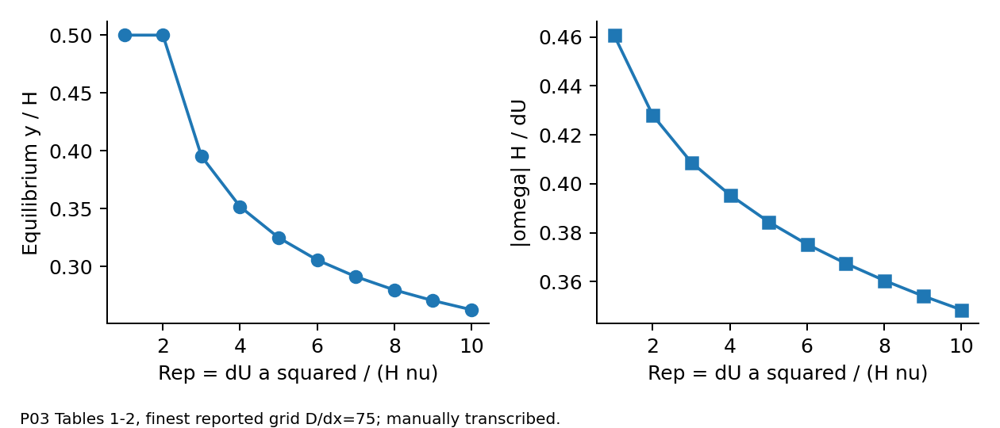{width=95%}

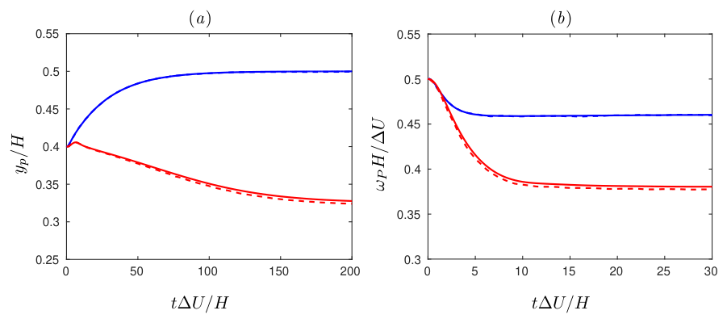{width=90%}

**Comparison protocol:** output $y/H$ and $\omega H/\Delta U$ versus $t\Delta U/H$. Establish an equilibrium window from stable mean values rather than using the final timestep alone. Report equilibrium-position error, spin error, and transient error separately. A drag-only particle with no lift or torque mechanism cannot validate against this migration result.

# 4 Two discs with and without direct contact

**DK01 and WK01. Source P01, Sections 5.2.1--5.2.2.** Both cases are genuinely 2D, initially quiescent, with all outer boundaries no-slip. In this source, the first coordinate points along gravity. Values below retain the source computational units; do not mix them with SI values from another benchmark.

| Input | DK01 drafting kissing tumbling | WK01 wake interaction |
|:--|:--|:--|
| Domain | $[0,6]\times[-1,1]$ | $[0,10]\times[-1,1]$ |
| Radii | 0.125, 0.125 | 0.1, 0.1 |
| Initial centers | $(1,0.001),(1.5,-0.001)$ | $(0.8,-0.13),(1.2,0.13)$ |
| Density ratios | 1.5, 1.5 | 1.5, 1.25 |
| Kinematic viscosity | 0.01 | 0.0008 |
| Gravity | $(981,0)$ | $(9.81,0)$ |
| Reference mesh and timestep | $h=1/256,\Delta t=10^{-4}$ | $h=1/200,\Delta t=10^{-3}$ |
| Source figures | 6--8 | 9--14 |

DK01 uses the cited short-range repulsion with stiffness $5\times10^{-7}$ and range $3h$. WK01 has no direct contact; the reported final time is 8.629. Reference curves need digitization. Preserve the small initial transverse offsets.

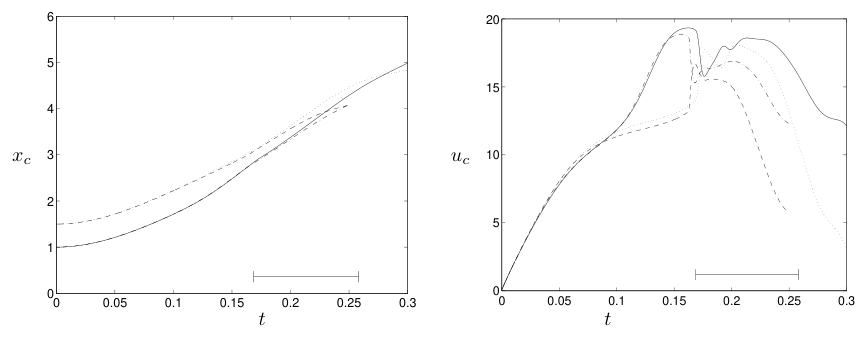{width=90%}

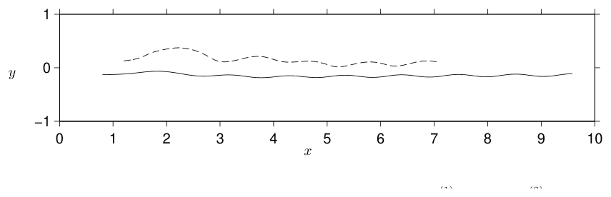{width=90%}

**Comparison protocol:** report both center coordinates, both velocity components and spin for each disc. For DK01 also compare minimum gap, onset of close interaction, role exchange and separation. Score the pre-contact interval separately. During unstable tumbling, a small perturbation can change phase and direction; an apparent exact long-time match is not the only relevant criterion. For WK01, assess the lighter disc's lateral deviation and both speed histories before introducing a contact model.

# 5 Additional two dimensional settling cases

**GS01--GS08. Source P02, Sections 4.4 and 5.** These are 2D circular particles with $D=0.08$ cm, fluid density 1 and solid density 1.01 g/cm$^3$, and channel length 3 cm. Pair centers start $2D$ apart. The original formulation uses immersed tethered walls inside a periodic background and an IB Boussinesq treatment. Its wall geometry and small compliance should be retained.

| Case | Initial arrangement | $W/D$ | Reported final $Re$ | Figures |
|:--|:--|--:|--:|:--|
| GS01 | Centered vertical pair | 8 | 3 | 16 |
| GS02 | Centered vertical pair | 8 | 14 | 17 |
| GS03 | Centered vertical pair | 8 | 80 | 18--20 |
| GS04 | Offset vertical pair | 4 | 1.5 | 21 |
| GS05 | Offset vertical pair | 4 | 2 | 21--23 |
| GS06 | Offset vertical pair | 4 | 10 | 21 |
| GS07 | Offset vertical pair | 4 | 47 | 24--25 |
| GS08 | Offset single particle | 4 | 4.9 | 9--11 |

These are grade C: exact viscosity assignments and absolute initial heights were not recovered. Final Reynolds number is an observed label, not a substitute for viscosity. The figures can guide acquisition, but do not yet form a complete quantitative reproduction specification.

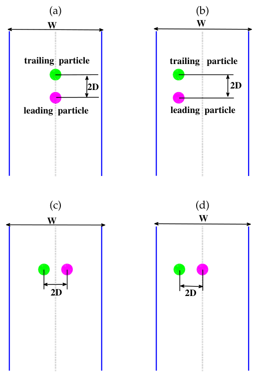{width=80%}

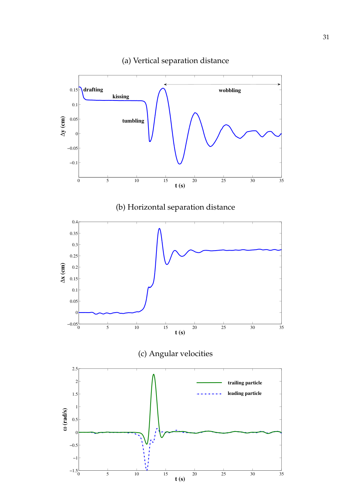{width=85%}

**Comparison protocol:** obtain the missing inputs first. Record whether symmetry is preserved, whether a pair realigns, and whether leading/trailing identities exchange. Measure separation in units of $D$ and rotation with an explicit sign convention. For long integrations in a periodic channel, account for image interactions and unwrapped center coordinates. These cases are useful for qualitative topology and instability checks before an exact curve comparison becomes available.

# 6 Experimental settling of a sphere in a box

**TC01--TC04. Source P04, Table I and Figure 5.** A 15 mm nylon sphere of density 1120 kg/m$^3$ settles in a $100\times100\times160$ mm container. The reported release height is 120 mm. It is a 3D sphere experiment with planar PIV, not a 2D cylinder benchmark. Verify the source height ordinate and upper boundary treatment before reproducing the transient.

| Case | $\rho_f$ kg/m$^3$ | $\mu$ Pa s | Nominal $Re$ | Nominal $U_\infty$ m/s |
|:--|--:|--:|--:|--:|
| TC01 | 970 | 0.373 | 1.5 | 0.038 |
| TC02 | 965 | 0.212 | 4.1 | 0.060 |
| TC03 | 962 | 0.113 | 11.6 | 0.091 |
| TC04 | 960 | 0.058 | 31.9 | 0.128 |

The viscosity header in the paper is mPa s; the table above converts to Pa s. $U_\infty$ is an unbounded-medium reference, not the measured confined plateau. Compare position, speed, bottom deceleration and PIV. Source curves require digitization; original arrays were not located. The later Basilisk example changes the box geometry and must not replace the experiment's dimensions.

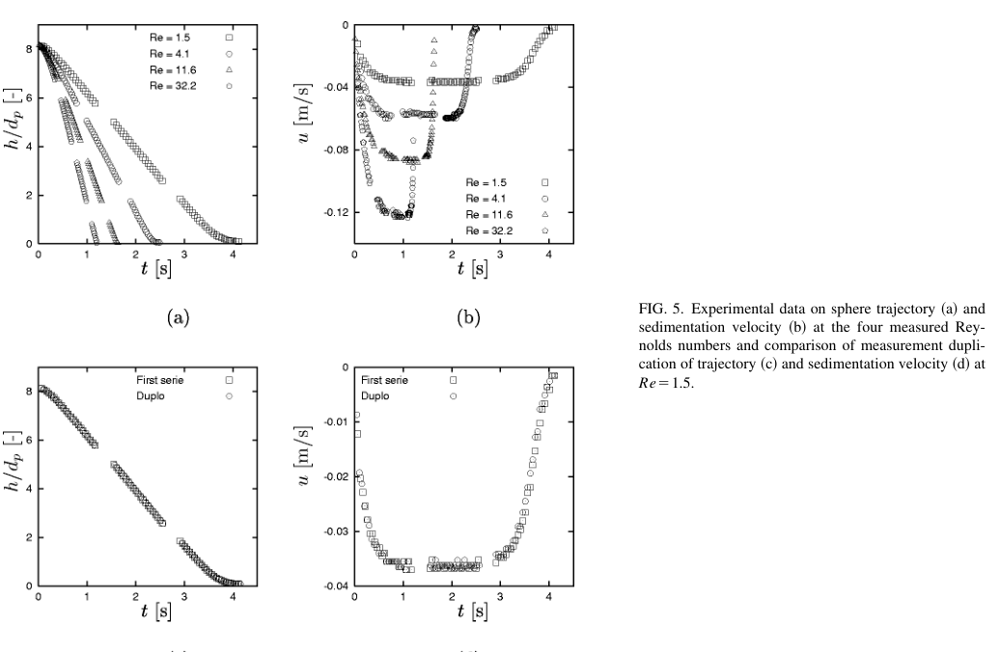{width=95%}

**Comparison protocol:** preserve the measured fluid and particle properties, define whether height denotes center position or surface clearance, and match the camera time origin. Include added mass, history or wall effects only through a stated model. Compare acceleration, mid-flight settling, and bottom approach in separate windows. Do not interpret agreement with only the nominal unbounded speed as validation of the complete experiment.

# 7 Sphere settling with official numerical reference arrays

**UD01--UD04. Source P05.** Density ratio is 1.5. The selected large-domain references AL--DL use a cylindrical computational domain of diameter $7.54d$ and length $15d$, with the particle $5d$ from the upstream plane in a translating frame. Use quiescent inflow and the specified stress-free lateral/outflow boundaries. The velocity scale is $U_g=\sqrt{(\rho_p/\rho_f-1)gd}$; $Ga=U_gd/\nu$.

| Case | Reference | $Ga$ | Regime | Included target |
|:--|:--|--:|:--|:--|
| UD01 | AL | 144 | Steady vertical | Wake profiles, pressure; $u_V=-1.285U_g$ |
| UD02 | BL | 178.46 | Steady oblique | Profiles, pressure; $u_V=-1.356U_g$, $u_H=0.1245U_g$ |
| UD03 | CL | 190 | Periodic oblique | Velocity and spin time series |
| UD04 | DL | 250 | Chaotic | PDFs and autocorrelations |

Official MAT files are included under `data/sphere_original`. Converted periodic and statistical curves are also supplied. The sign convention takes vertical settling velocity negative. These are asymptotic benchmark states, not standardized release-from-rest trajectories. Use the original definitions of fluctuation amplitudes and projected velocity components.

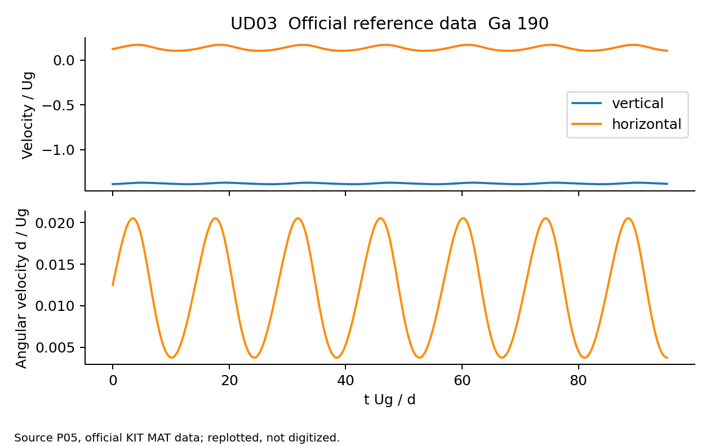{width=95%}

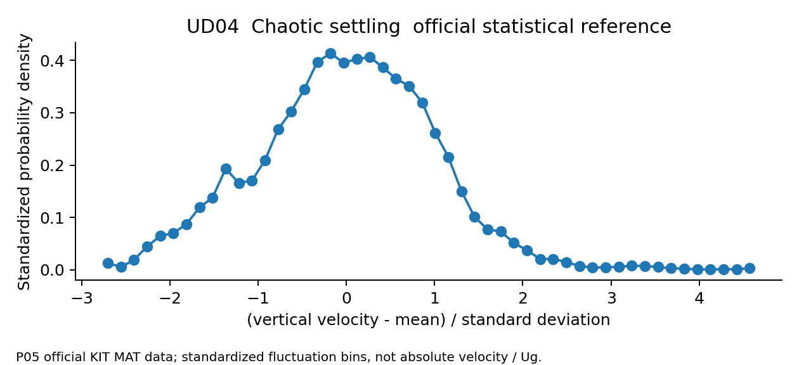{width=95%}

**Comparison protocol:** for steady cases compare velocities, pressure and wake profiles in the same particle-attached coordinate system. For UD03 report mean, amplitude, frequency and phase separately; a phase-adjusted error must be labeled alongside an unshifted result. For UD04 compare statistically converged PDFs, means, variances and autocorrelations. Do not demand pointwise equality of chaotic trajectories. The PDF bins use mean-subtracted fluctuations divided by their standard deviation; their densities are correspondingly standardized. These bins are not absolute velocities divided by $U_g$. The original MATLAB readers and data sheets are included to preserve these conventions.

# 8 Oblate particles with official numerical data

**OB01--OB06. Source P06 and the official 4TU data set.** Aspect ratio is $\chi=d/a$, where $d$ is equatorial diameter. The source scale is $U_g=\sqrt{(\rho_p/\rho_f-1)gV_p/d^2}$, $V_p=\pi d^3/(6\chi)$; it differs from the sphere scale in Section 7. Domain radius is $2.67d$, length $15d$, upstream distance $5d$. Boundary conditions are quiescent inflow and stress-free sides/outflow.

| Case | Data folder | $\chi$ | $Ga$ | $\rho_p/\rho_f$ | Regime |
|:--|:--|--:|--:|--:|:--|
| OB01 | A11-M100 | 1.1 | 100 | 2.10 | Steady vertical |
| OB02 | B11-M100 | 1.1 | 115 | 2.10 | Steady oblique |
| OB03 | B15-M075 | 1.5 | 110 | 2.14 | Steady oblique |
| OB04 | C15-M075 | 1.5 | 150 | 2.14 | Vertical periodic |
| OB05 | D11-M100 | 1.1 | 200 | 2.10 | Chaotic |
| OB06 | D15-M500 | 1.5 | 220 | 14.32 | Chaotic |

Original MAT files, source README and converted curves are included. The official repository records CC0 licensing. Compare profiles for steady cases, the supplied velocity/spin series for OB04, and statistics for OB05--OB06. Rotation, shape and orientation physics are required.

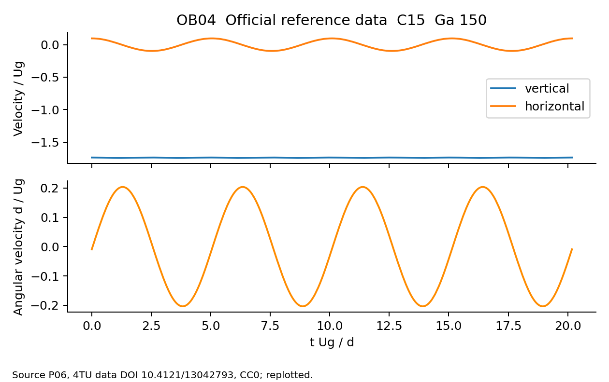{width=95%}

**Comparison protocol:** build the same equatorial and symmetry-axis dimensions; do not replace the particle by an equal-volume sphere. Match the inertia tensor as well as volume and density. Transform the flow into the source trajectory-attached frame before comparing relative velocities. Report orientation conventions explicitly. The supplied temporal file does not contain every possible orientation variable, so consult the original MAT inventory rather than assuming a column exists.

# 9 Experimental wall approach and impact with planar tracking

**HG01--HG07. Source P07, Table 1, and Mendeley Data V1.** Seven sphere types settle in a 110 mm diameter cylinder. Fluid density is 1141 kg/m$^3$ and viscosity 0.008 Pa s. The repository provides in-plane coordinates and velocities at 1 ms intervals. Position is in mm, velocity in m/s, and positive vertical direction points upward from the bottom center.

| Case | Repository folder | Actual diameter mm | Density kg/m$^3$ | Nominal terminal $Re$ |
|:--|:--|--:|--:|--:|
| HG01 | Steel_16 | 16.7 | 7729 | 4012 |
| HG02 | Steel_14 | 14.4 | 7604 | 3182 |
| HG03 | PTFE_20 | 20 | 2170 | 2078 |
| HG04 | PTFE_10 | 10 | 2158 | 730 |
| HG05 | PTFE_06 | 6 | 2122 | 333 |
| HG06 | POM_20 | 20 | 1351 | 939 |
| HG07 | Rubber_22 | 22 | 1361 | 1109 |

The public repository was verified; file transfer returned 403, so measurements are **linked, not bundled**. It lists 30 repetitions across the seven types; repetitions are not counted as additional benchmark families. Retrieve `CenterCoord.mat`, `Vx.mat`, `Vy.mat` and `Summary.fig`. Folder sizes are nominal: use measured diameters above. Rubber absorption and unmeasured out-of-plane motion complicate interpretation.

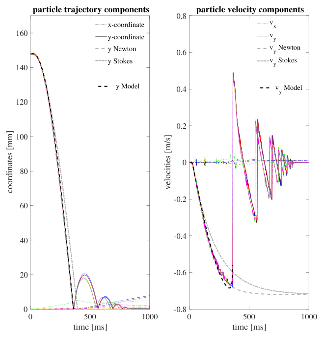{width=95%}

**Comparison protocol:** obtain release state and impact-object geometry from the measurement record and paper, then initialize a matched run. Convert mm to m exactly once. Calculate gap using center height minus radius and the actual target elevation. Use all repetitions to estimate variability. Compare pre-impact deceleration and normal restitution separately. A prescribed dry restitution coefficient alone does not predict the effective wet restitution of the coupled experiment.

# 10 Gaussian parcel cases closest to the requested framework

**AP01--AP03. Source P08, Tables 1--3.** These cases use Gaussian transfer with finite-volume displacement and a separate contact model. They are 3D, including the thin-box visualizations.

| Case | Geometry and selected inputs | Main reference |
|:--|:--|:--|
| AP01 settling | Box $0.2\times0.6\times0.0275$ m; $d=500\ \mu$m; densities 1.254 and 2500 kg/m$^3$; 1000 parcels; multiplicity 3375; initial concentration 0.2 | Fig. 1 |
| AP02 jet fluidization | Same box; 9 m/s jet of diameter 0.04 m; 2880 parcels; multiplicity 3375; initial concentration 0.4 | Figs. 2--5 |
| AP03 bed mobilization | Box $63\times12\times12$ cm; $d=0.9$ cm; densities 1 and 10 g/cm$^3$; viscosity 1 P; 3780 particles; centerline speed 360 cm/s | Figs. 6--8 |

Compare interface or bed evolution, concentration and mean fluid velocity. Initial realization, some boundary/contact details, and machine reference curves remain unresolved, so these are grade C. The pack records further reported inputs. Maintain total represented mass when refining parcels; a changed population is not a clean convergence test.

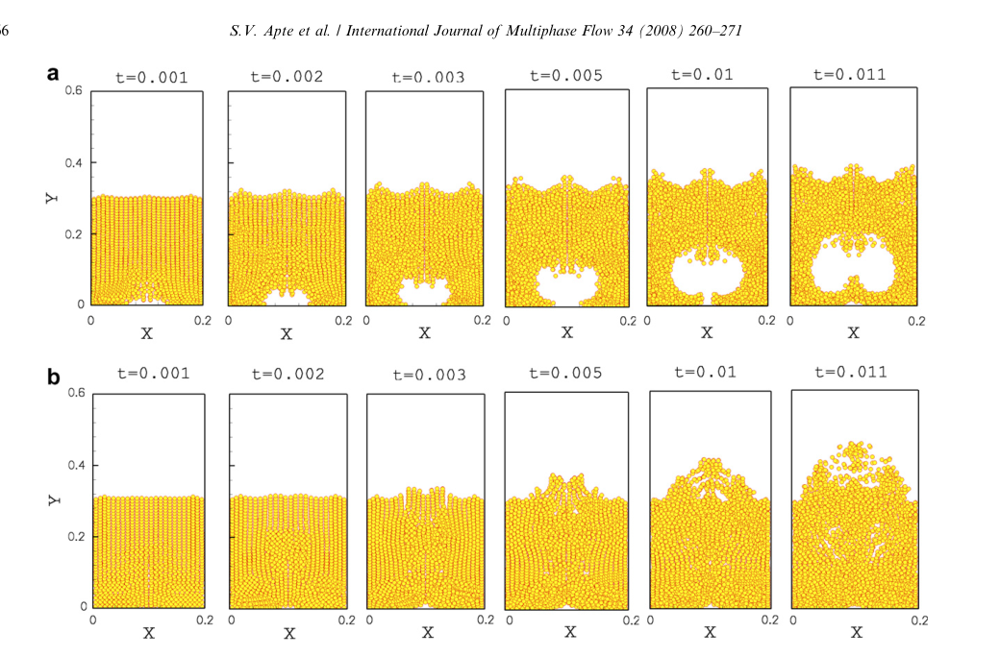{width=95%}

**Comparison protocol:** first reproduce the source concentration and boundary conditions. Use an ensemble of random initial particle realizations if the original seed is unavailable. Compare plane-averaged quantities and their variation across realizations, not a particular snapshot's individual particle positions. A model with $\nabla\cdot\mathbf u=0$ everywhere and no displacement closure does not reproduce a finite-volume-fraction source merely by matching its Gaussian kernel.

# 11 Literature verification of regularized coupling

**ER01--ER03. Source P09, Section 3.** ER01 applies a localized constant force to initially quiescent fluid and checks impulse and the regularized disturbance. ER02 imposes a settling point-particle trajectory and checks the induced field. ER03 lets the particle and fluid interact while subtracting self-disturbance and compares its velocity to the heavy-particle Stokes target. Source figures are 3--8, 9--10 and 11 respectively.

These are particularly relevant to Gaussian momentum spreading. ERPP also has a physically derived diffusion/regularization procedure and time treatment; it is not synonymous with an arbitrary Gaussian body force. The source's complete force, mesh, domain and regularization settings must be extracted before claiming an exact reproduction. The included `analytic_stokes.csv` is an independently generated normalized target, not digitized paper data. For a periodic fluid domain, distinguish its zero Fourier mode from a free-space solution.

**Comparison protocol:** confirm the integrated impulse first, then near-field and far-field errors, then the particle response. Quantify sensitivity to width/grid ratio and to physical diameter/width ratio. Report results with and without the implemented self-disturbance correction to isolate its effect. This comparison should diagnose a particular coupling mechanism rather than absorb its error into a fitted drag coefficient.

# 12 Further moving sphere and DKT variants

**FR01--FR03, source P03 Sections 4.2--4.3.** FR01 and FR02 release a neutrally buoyant sphere into a uniform stream at $Re=20$ and 100 after holding it fixed until its flow is steady. The domain is $30D\times5.34D\times5.34D$, with release $5D$ from inflow. FR03 adds initial rotation $\omega_zD/U=-1$ at $Re=100$, generating lateral motion and decaying spin. Its lateral boundaries are periodic, replacing the free-slip sides of FR01--FR02. Gravity is zero. Compare velocities and spin in Figures 3 and 5--7; digitize curves before scoring. These are 3D spheres.

**LD01, source P10 Section 3.2.** Two 2 mm spheres begin at $(0.01,0.01,0.072)$ and $(0.0099,0.01,0.069)$ m in a $0.02\times0.02\times0.08$ m domain. The displayed case has terminal $Re=18.18$, periodic horizontal boundaries and a no-slip bottom. Upper-boundary and material-property details still need extraction. Compare Figures 5--8. This is 3D DKT, even when the path looks planar.

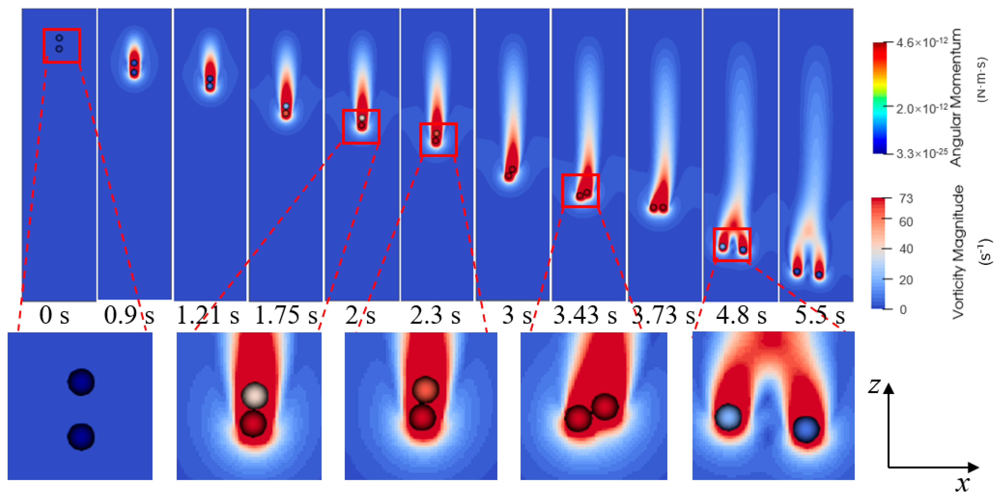{width=100%}

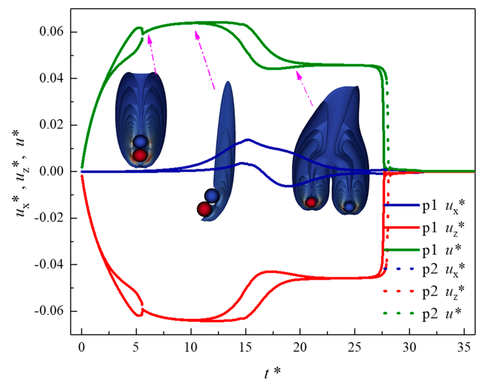{width=85%}

**Comparison protocol:** retain the small transverse offset and the sphere-size Reynolds definition. Record the actual gap and role exchange along with speeds. A qualitative drafting sequence is insufficient for quantitative validation; compare time, speed, orientation, separation and grid sensitivity with a fixed physical contact model.

# 13 Ten checks that can be run before reproducing papers

The following are independently specified verification tests for the equations in the companion note. They do not represent new experiments or copied author datasets. Their exact targets help separate implementation errors from model-form limitations.

## V01 Stokes response and displacement

Use $dv/ds=1-v$, $v(0)=0$, $s=t/\tau$. Exact velocity is $v=1-e^{-s}$ and normalized displacement is $s-1+e^{-s}$. Test $0\le s\le5$. The file `data/analytic_stokes.csv` contains both. Compare temporal convergence and position integration, not velocity alone. This verifies the chosen reduced ODE, not unsteady hydrodynamic history forces.

## V02 Closed two way momentum relaxation

Use total fluid mass $M_f=1$, particle mass $M_p=0.25$, drag response time $\tau=0.2$, initial $u=0$, $v=1$, no gravity and a spatially uniform fluid mode. The equations are $\dot v=(u-v)/\tau$ and $M_f\dot u=-M_p\dot v$. Hence

$$u(t)=0.2-0.2e^{-6.25t},\qquad v(t)=0.2+0.8e^{-6.25t}.$$

Total momentum is 0.25 at every time. Compare with `data/analytic_two_way_relaxation.csv`. Drag must reduce combined kinetic energy. This verifies the uniform momentum mode and equal/opposite integrated impulses, not a particle wake.

## V03 Gaussian normalization and boundary crossing

For a 2D kernel of width $h=0.1$, move its center across a unit square, including close to walls or a periodic seam. Use actual cell areas and normalize the retained stencil. Test $\sum_aW_{ai}\Delta A_a=1$ and exact interpolation of a constant field. Refine the grid and stencil cutoff separately. A normalized truncated Gaussian need not preserve its first moment near a wall; do not falsely impose an unbounded moment target there.

## V04 Gaussian overlap

For 3D unbounded kernels of widths $h_1=0.5$, $h_2=0.75$ and separation $r$,

$$I(r)=[2\pi(h_1^2+h_2^2)]^{-3/2}
\exp[-r^2/(2(h_1^2+h_2^2))].$$

Numerically integrate the product of the kernels and compare to `data/analytic_gaussian_overlap3d.csv`. In a periodic box sum image contributions. For bounded renormalized kernels use the actual bounded overlap instead; the unbounded formula is not exact there.

## V05 Head on inelastic impact

Use two equal physical masses $m_1=m_2=1$, velocities $(1,0)$ and $(-1,0)$, contact normal from particle 2 toward particle 1 equal to $(-1,0)$, and restitution $e=0.8$. The post-impact velocities are $(-0.8,0)$ and $(0.8,0)$. Momentum remains zero; kinetic energy changes from 1 to 0.64. Apply once to an approaching contact. A statistical parcel requires its own weighted collision interpretation.

## V06 Oblique frictionless elastic impact

Use the same normal and equal masses, with velocities $(1,0.5)$ and $(-1,-0.5)$ and $e=1$. Expected velocities are $(-1,0.5)$ and $(1,-0.5)$. Tangential components are unchanged; momentum and total energy 1.25 are conserved. This is a useful fully 2D collision-algebra check.

## V07 Wall reflection

For a stationary horizontal frictionless wall with upward normal, incoming velocity $(2,-3)$ and $e_w=0.6$, the outgoing velocity is $(2,1.8)$. Check the normal restitution and preserved tangential speed. Wet restitution cannot be inferred from this dry/kinematic check.

## V08 Statistical collision rate

For the independent monokinetic Gaussian-cloud construction, the expected physical count between distinct parcels is $\Lambda=N_iN_jK_{ij}I_{ij}\Delta t$. As a fixed synthetic test choose $N_i=N_j=1000$, $r_i=r_j=10^{-4}$ m, relative speed $0.01$ m/s, $h_i=h_j=0.005$ m, center separation $0.005$ m and $\Delta t=0.001$ s. Set collision efficiency to one. Compute the target from these values and compare ensemble event counts with confidence intervals.

For equal-weight representative group events, divide the physical count by 1000. Do not compare group-event count directly with physical collision count. For rare independent events, the Poisson standard deviation is $\sqrt{\Lambda}$ for a single count window; independent repetitions reduce uncertainty of its mean. Rates must be recomputed after state-changing impacts.

## V09 Parcel and kernel convergence

Represent a fixed physical population of 10,000 particles with 10, 50 and 100 equal-weight parcels. Use a controlled population representation. For deterministic force-transfer invariance, split each parent into coincident children with weights summing to its original weight; the deposited force should be unchanged. A physically dispersed refinement additionally needs matched spatial and velocity distributions. Keep total mass, size distribution and physical collision kernel fixed. Study sampling uncertainty independently of mesh and width sensitivity.

## V10 Two dimensional Taylor Green fluid test

On $[0,2\pi]^2$ with periodic boundaries and $\nu=0.01$, use

$$u=\sin x\cos y\,e^{-2\nu t},\qquad
v=-\cos x\sin y\,e^{-2\nu t},$$
$$p/\rho_f=\tfrac14(\cos2x+\cos2y)e^{-4\nu t}.$$

There are no particles or external forces. Check divergence, velocity and pressure errors, and viscous decay under refinement. This is a carrier-fluid verification test, not validation of parcel coupling.

# 14 Metrics and a defensible comparison procedure

For every run, record geometry, dimension, density and viscosity units, initial states, boundaries, force and torque models, contact/lubrication model, mesh, timestep, kernel width, cutoff, parcel multiplicity and random seed. Keep the source definition of Reynolds, Galileo and Stokes numbers with the run. Identical dimensionless-number names do not guarantee identical definitions.

For samples $a_k$ and references $a_k^r$, useful errors are

$$RMSE=\sqrt{N^{-1}\sum_k(a_k-a_k^r)^2},\quad
E_{\infty}=\max_k|a_k-a_k^r|,$$
$$E_{L2}=\frac{\|a-a^r\|_2}{\|a^r\|_2},\qquad
NRMSE=\frac{RMSE}{a_{scale}}.$$

Choose and report a physically meaningful $a_{scale}$; avoid dividing a near-zero lateral reference by itself. For trajectories, also report position error normalized by particle diameter, endpoint error, velocity components and contact-event timing. For fields, define the common spatial region and quadrature. For bed/interface positions state the threshold used to locate the interface.

## Agreement and uncertainty

An acceptance rule should combine reference uncertainty, digitization uncertainty, numerical convergence and the intended model's accuracy. Establish it before examining the final result. For example, a project may require a diameter-normalized position error and a velocity error to remain below declared thresholds across a selected time window. That is a project choice, not a threshold supplied by this atlas.

For stochastic simulations use independent seeds and report mean and uncertainty, increasing the ensemble until sampling uncertainty is smaller than the discrepancy being discussed. For chaotic deterministic flows compare robust statistics over compatible sampling windows. Do not shift or rescale axes silently to improve agreement.

## Plot digitization protocol

1. Select the correct figure, panel, curve, symbol set and case parameters.
2. Calibrate both axes, including logarithmic scaling if present. Record source units.
3. Extract data points from the original-resolution figure. Distinguish experiment markers from numerical lines.
4. Estimate reading uncertainty from pixel resolution and repeated selections.
5. Save the figure/panel identity, extraction method and uncertainty with the CSV.
6. Replot extracted points over the source figure before using them as a quantitative target.

No curves have been silently digitized in this package. The included official arrays are original downloadable numerical references. The Couette equilibrium values are manually transcribed source-table values. All synthetic reference curves are explicitly analytical.

# 15 How to use the supplied files

## Folder contents

| File or folder | Purpose |
|:--|:--|
| `case_catalog.json` | Detailed inputs, targets, missing items and compatibility for all 51 cases |
| `case_catalog.csv` | Searchable case index with the same records |
| `sources.json` | Primary article and dataset links |
| `data/sphere_original` | Official sphere reference MAT variables and source README |
| `data/spheroid_original` | Official spheroid reference MAT variables and source README |
| `data/mat_inventory.json` | Original variable names, shapes and data types |
| `data/*.csv` | Converted reference curves, numerical table and analytical checks |
| `figures` | Source figure excerpts and explicitly labeled reference-data plots |
| `templates` | Simulation, digitization and run-log headers |
| `tools/compare.py` | Curve comparison, error metrics and plot generation |

The pack contains **31 original MAT files and 32 reference CSV files**. Some MAT files contain field/profile matrices that are preserved in their original format rather than flattened ambiguously. Read them with MATLAB or `scipy.io.loadmat`. Scalar metadata remain available in the originals. The official sphere data directory did not expose an explicit reuse license during retrieval; retain attribution and consult its terms before wider redistribution. The spheroid data record specifies CC0.

## Comparison examples

From the unpacked folder, install the Python requirements and run:

```bash
python -m pip install -r tools/requirements.txt
python tools/compare.py \
  --reference data/analytic_stokes.csv \
  --simulation my_stokes.csv \
  --x time_over_tau --y v_over_vt \
  --scale 1 --out results/stokes
```

The simulation CSV must use the same normalization. To compare a periodic sphere velocity:

```bash
python tools/compare.py \
  --reference data/sphere190_timeseries.csv \
  --simulation my_sphere190.csv \
  --x time_evol --y uv \
  --scale 1 --out results/sphere190_vertical
```

For Couette equilibrium, export one row per Reynolds number and compare the sweep:

```bash
python tools/compare.py \
  --reference data/couette_equilibrium.csv \
  --simulation my_couette_equilibrium.csv \
  --x Re --y yeq_over_H \
  --scale 1 --out results/couette
```

Use different simulation column names with `--simulation-x` and `--simulation-y`. The tool creates `overlay.png`, `comparison.csv` and `metrics.json`. It interpolates simulation values onto reference points only within common support, reports missing coverage, and never extrapolates or performs hidden unit conversion or time shifting. `--abs-tol` and `--rel-tol` are optional user-selected pointwise thresholds. A tolerance result applies only to compared points and is not a whole-case pass verdict.

The comparator was checked against exact agreement, a known additive error, partial support, and nonoverlapping inputs. This verifies the comparison utility; it does not certify the user's future solver.

# 16 Additional primary literature worth extending

These are further credible benchmark sources identified during the search. They are **not counted in the 51 configured variants** because complete reproducibility details or data were not assembled. They expand the collection without disguising incomplete leads as ready benchmarks.

| Source and direct address | Additional target | Required next step |
|:--|:--|:--|
| Pianet and Arquis (2008), [DOI 10.1016/j.euromechflu.2007.07.001](https://doi.org/10.1016/j.euromechflu.2007.07.001) | Explicit 2D settling cylinder in wall-bounded box | Acquire full benchmark parameter/velocity tables |
| Feng, Hu and Joseph (1994), [author abstract](https://personal.math.ubc.ca/~jfeng/Publications/Abstracts/94_JFM1.htm) | 2D circular/elliptic settling and pair-interaction regimes | Recover exact geometry and parameter points |
| Pischke, Cordes and Kneer (2012), [DOI 10.1016/j.ijmultiphaseflow.2011.09.002](https://doi.org/10.1016/j.ijmultiphaseflow.2011.09.002) | Gaussian/ellipsoidal statistical collision estimator | Reproduce anisotropic population and collision-rate tests |
| Pischke, Kneer and Schmidt (2015), [DOI 10.1016/j.compfluid.2015.01.018](https://doi.org/10.1016/j.compfluid.2015.01.018) | Comparative collision algorithm validation | Obtain exact test definitions and error statistics |
| Gondret, Lance and Petit (2002), [author PDF](https://ariane.fast.u-psud.fr/~gondret/POF2002.pdf) | Wet normal restitution and successive rebound | Extract material, wall and Stokes-number conditions |
| Joseph et al. (2001), [publisher](https://www.cambridge.org/core/journals/journal-of-fluid-mechanics/article/AA9C176CEDAC4CB1D40847D2E68C3F65) | Measured viscous particle-wall approach and rebound | Preserve pendulum geometry; do not substitute free fall |
| Verjus et al., [preprint 1611.09349](https://arxiv.org/abs/1611.09349) | 2D settling-pair stable and chaotic regimes | Extract exact parameters, initial perturbations and statistics |
| Capecelatro and Desjardins (2013), [author PDF](https://ctflab.mae.cornell.edu/papers/Capecelatro,%20Desjardins.%202013.%20An%20Euler-Lagrange%20strategy%20for%20simulating%20particle-laden%20flows.pdf) | Volume-filtered fluidized-bed and spout validation | Match experimental inlet and contact specifications |

# 17 Primary references and data provenance

**P01 Uhlmann (2005).** *An immersed boundary method with direct forcing for the simulation of particulate flows*. Journal of Computational Physics 209, 448--476. [DOI](https://doi.org/10.1016/j.jcp.2005.03.017), [author preprint](https://arxiv.org/abs/1809.08170). Source numerical figures; no original trajectory arrays located.

**P02 Ghosh and Stockie (2013).** *Numerical simulations of particle sedimentation using the immersed boundary method*. [Author preprint](https://arxiv.org/abs/1304.0804), [author PDF](https://www.sfu.ca/~jstockie/papers/cicp13settling.pdf). True 2D numerical cases; full parameter assignment still incomplete here.

**P03 Garcia-Villalba, Fuentes, Dusek, Moriche and Uhlmann (2023).** *An efficient method for particle-resolved simulations of neutrally buoyant spheres*. Computers and Fluids 263, 105936. [DOI](https://doi.org/10.1016/j.compfluid.2023.105936), [author preprint](https://arxiv.org/abs/2305.16061). Couette table transcribed from Tables 1--2; finest-grid values, not experimental measurements.

**P04 ten Cate, Nieuwstad, Derksen and van den Akker (2002).** *Particle imaging velocimetry experiments and lattice-Boltzmann simulations on a single sphere settling under gravity*. Physics of Fluids 14, 4012--4025. [DOI](https://doi.org/10.1063/1.1512918), [institutional PDF record](https://repository.tudelft.nl/record/uuid:f3f9724f-906d-4938-a15c-a661e63eb203). Figure excerpt supplied for comparison; original machine data not located.

**P05 Uhlmann and Dusek (2014).** *The motion of a single heavy sphere in ambient fluid: a benchmark for interface-resolved particulate flow simulations with significant relative velocities*. International Journal of Multiphase Flow 59, 221--243. [DOI](https://doi.org/10.1016/j.ijmultiphaseflow.2013.10.010), [preprint](https://arxiv.org/abs/1310.5358), [official dataset directory](https://www.iwu.kit.edu/nfm/dns_data/particles/single_sphere_sedimentation/). Data downloaded as `all_data_etc.tgz`; original MAT values preserved.

**P06 Moriche, Uhlmann and Dusek (2021).** *A single oblate spheroid settling in unbounded ambient fluid: a benchmark for simulations in steady and unsteady wake regimes*. [Author preprint](https://arxiv.org/abs/2011.07506), [official data DOI](https://doi.org/10.4121/13042793), [data sheet](https://www.iwu.kit.edu/nfm/dns_data/particles/single_spheroid_sedimentation/doc/data-sheet.pdf). Files retrieved from the official Figshare/4TU record; CC0. Original MAT arrays preserved and selected curves exported without fitting or smoothing.

**P07 Hagemeier, Thevenin and Richter (2021).** *Settling of spherical particles in the transitional regime*. International Journal of Multiphase Flow, article 103589. [DOI](https://doi.org/10.1016/j.ijmultiphaseflow.2021.103589), [author preprint](https://arxiv.org/abs/2009.02250). [Hagemeier dataset V1](https://data.mendeley.com/datasets/mf27c92nc3/1), DOI 10.17632/mf27c92nc3.1, CC BY 4.0. Dataset page verified but files not downloaded; grade C until acquired.

**P08 Apte, Mahesh and Lundgren (2008).** *Accounting for finite-size effects in simulations of disperse particle-laden flows*. International Journal of Multiphase Flow 34, 260--271. [DOI](https://doi.org/10.1016/j.ijmultiphaseflow.2007.10.005), [author PDF](https://dept.aem.umn.edu/~kmahesh/globalassets/publpdf/journal/apte_ijmf.pdf). Source numerical parcel cases; source figure excerpt, not original machine arrays.

**P09 Gualtieri, Picano, Sardina and Casciola (2015).** *Exact regularized point particle method for multiphase flows in the two-way coupling regime*. Journal of Fluid Mechanics 773, 520--561. [Author preprint](https://arxiv.org/abs/1405.6969). Literature verification targets; analytical CSV in this package independently generated from the stated formula.

**P10 Li et al. (2022).** *IBM-LBM-DEM Study of Two-Particle Sedimentation: Drafting-Kissing-Tumbling and Effects of Particle Reynolds Number and Initial Positions of Particles*. Energies 15, 3297. [DOI](https://doi.org/10.3390/en15093297), [full text](https://www.mdpi.com/1996-1073/15/9/3297). Figures 5--6 reproduced as source excerpts under the article's CC BY license. These describe 3D motion.

All retrieval and access-status checks were performed on 15 October 2026. Figure numbers refer to the specified paper or author-preprint version. Article figures are reference excerpts with attribution, not outputs generated by the user's solver. Full copyrighted article PDFs are not redistributed in the package.
